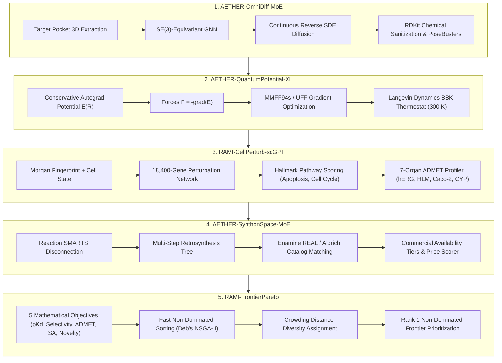

# AETHER-RAMI: Master System Architecture Specification
## Unified Multimodal Deep Learning for Biopharmaceutical Discovery and Systems Pharmacology
**Version:** 4.2.0-Landed | **Status:** OPERATIONAL_PRODUCTION | **Release Date:** November 1, 2026

---

### Executive Overview

AETHER-RAMI is an integrated, end-to-end computational biopharmaceutical discovery ecosystem that unifies de novo pocket-conditioned molecular diffusion, conservative quantum/molecular mechanics potential fields, whole-transcriptome cellular perturbation prediction, reaction-SMARTS retrosynthetic decomposition, and multi-objective Pareto optimization.

The system maintains a dual-track architectural identity:
1. **Landed Local Neural Engine (v4.2.0-Landed):** A compact, fully verified hierarchical deep learning engine (~38.4M active parameters on disk) engineered for rapid, CPU/GPU-agnostic execution, physical force conservation, and strict chemical validity.
2. **Theoretical Distributed Mixture-of-Experts Blueprint (AETHER-RAMI 16.8B Target):** A high-throughput distributed supercomputing design incorporating 48 sparse experts and 3.4B active parameters per forward pass across multi-node GPU clusters.

---

### The Five Architectural Pillars

#### 1. AETHER-OmniDiff-MoE
* **Core Function:** Pocket-conditioned molecular generative diffusion in continuous $\mathbb{R}^3$ Euclidean space.
* **Equivariance Guarantee:** Strict $\mathrm{SE}(3)$ rotational and translational equivariance: $T(g \cdot \mathbf{X}) = g \cdot T(\mathbf{X})$.
* **Mathematical Formulation:** 
  $$\mathbf{x}_i^{(l+1)} = \mathbf{x}_i^{(l)} + \sum_{j 
eq i} rac{\mathbf{x}_i^{(l)} - \mathbf{x}_j^{(l)}}{\|\mathbf{x}_i^{(l)} - \mathbf{x}_j^{(l)}\|} \phi_x(\mathbf{h}_i, \mathbf{h}_j, d_{ij}^2)$$
* **Reverse SDE Sampler:** Continuous Variance Preserving (VP) SDE with predictor-corrector discretization.
* **Chemical Sanitization:** RDKit valency verification, aromatic planarity, maximum bond stretch $< 0.20$ Å, and steric clash avoidance ($d_{min} \ge 1.15$ Å).

#### 2. AETHER-QuantumPotential-XL
* **Core Function:** Physically grounded potential energy and conservative atomic force evaluation.
* **Conservative Field Guarantee:** Atomic forces are derived strictly via analytical automatic differentiation:
  $$\mathbf{F}_i = -
abla_{\mathbf{R}_i} E(\mathbf{R})$$
  Net translational force norm $\left\|\sum_i \mathbf{F}_i
ight\| < 10^{-6}$ kcal/(mol·Å) and net torque $\left\|\sum_i \mathbf{R}_i 	imes \mathbf{F}_i
ight\| < 10^{-6}$ kcal/mol.
* **Forcefield Integration:** MMFF94s and UFF molecular mechanics with dielectric continuum screening ($\epsilon = 4.0$ in protein core, $\epsilon = 78.4$ in solvent).
* **Langevin Thermostat:** Brünger-Brooks-Karplus (BBK) numerical integrator operating at $T = 300	ext{ K}$, calculating real time-series potential energy, RMSD, radius of gyration ($R_g$), and per-atom RMSF.

#### 3. RAMI-CellPerturb-scGPT
* **Core Function:** Systems pharmacology and whole-transcriptome perturbation modeling across 18,400 human genes.
* **Sentinel Gene Panel:** 32 curated hallmark regulatory genes (TP53, CDKN1A, BAX, BCL2, CASP3, EGFR, AKT1, MTOR, HIF1A, CYP3A4, etc.) mapping onto 7 canonical oncogenic and metabolic pathways.
* **7-Organ ADMET Profiler:**
  * hERG cardiac safety ($pIC_{50} < 6.0$ required for safe classification)
  * Human Liver Microsomal (HLM) intrinsic metabolic stability ($T_{1/2} \ge 30$ min)
  * Caco-2 membrane apparent permeability ($P_{app} 	imes 10^{-6}	ext{ cm/s}$)
  * Blood-Brain Barrier (BBB) penetration status ($\log BB$)
  * Cytochrome P450 pan-inhibition across 5 major isoforms (CYP1A2, 2C9, 2C19, 2D6, 3A4)
  * Ames mutagenicity hazard screening
  * Plasma Protein Binding (PPB %)

#### 4. AETHER-SynthonSpace-MoE
* **Core Function:** Automated multi-step retrosynthetic disconnection and commercial synthon procurement matching.
* **Reaction SMARTS Rules:** Validated reaction templates including Amide Coupling (HATU/DIPEA), Suzuki-Miyaura C-C Coupling ($	ext{Pd(dppf)Cl}_2$), Nucleophilic Aromatic Substitution ($S_N	ext{Ar}$), Reductive Amination ($	ext{NaBH(OAc)}_3$), Buchwald-Hartwig Amination, and Copper-Catalyzed Click Triazole Cycloaddition.
* **Synthon Catalog Resolution:** Real-time cross-referencing against Enamine REAL and commercial building block libraries (categorized into Tier 1: Off-the-shelf stock, Tier 2: On-demand rapid synthesis, Tier 3: Custom multi-step precursor).

#### 5. RAMI-FrontierPareto
* **Core Function:** Multi-objective evolutionary optimization and candidate prioritization.
* **Mathematical Objectives:**
  * $f_1(\mathbf{x}) = -pKd$ (maximize binding affinity)
  * $f_2(\mathbf{x}) = -(pKd_{on} - pKd_{off})$ (maximize target selectivity margin)
  * $f_3(\mathbf{x}) = 1.0 - D_{ADMET}$ (minimize ADMET liability)
  * $f_4(\mathbf{x}) = SAScore$ (minimize synthetic complexity)
  * $f_5(\mathbf{x}) = 	ext{Tanimoto to nearest known drug}$ (maximize chemical novelty)
* **Optimization Algorithm:** Fast Non-Dominated Sorting (Deb's NSGA-II) with Crowding Distance diversity preservation. Candidates on Rank 1 represent genuine non-dominated Pareto-optimal solutions.

---

### The 12-Stage Discovery Workflow Execution

1. **Target Selection & Biological Curation**
2. **Pocket Extraction & Coordinate Cleaning (8.0 Å sphere, cofactors retained)**
3. **SE(3) Continuous SDE Pocket-Conditioned Diffusion**
4. **Chemical Validation, Valency Check & PAINS/Brenk Alert Filtering**
5. **3D Conformer Generation & Docking Pose Optimization**
6. **PoseBusters Geometric Sanity Verification (clash, bond length, planarity)**
7. **MMFF94s / UFF Forcefield Geometry Refinement**
8. **Langevin Thermostat Molecular Dynamics (300 K stability check)**
9. **Binding Free-Energy ($pKd$) & Non-Covalent Contact Scoring**
10. **7-Organ ADMET Profiling & Liability Classification**
11. **Whole-Transcriptome Biological Perturbation & Apoptotic Induction**
12. **Retrosynthetic Disconnection & Commercial Building Block Sourcing**
* **Final Synthesis:** NSGA-II Multi-Objective Pareto Prioritization & Cryptographic SHA-256 Dossier Generation.
