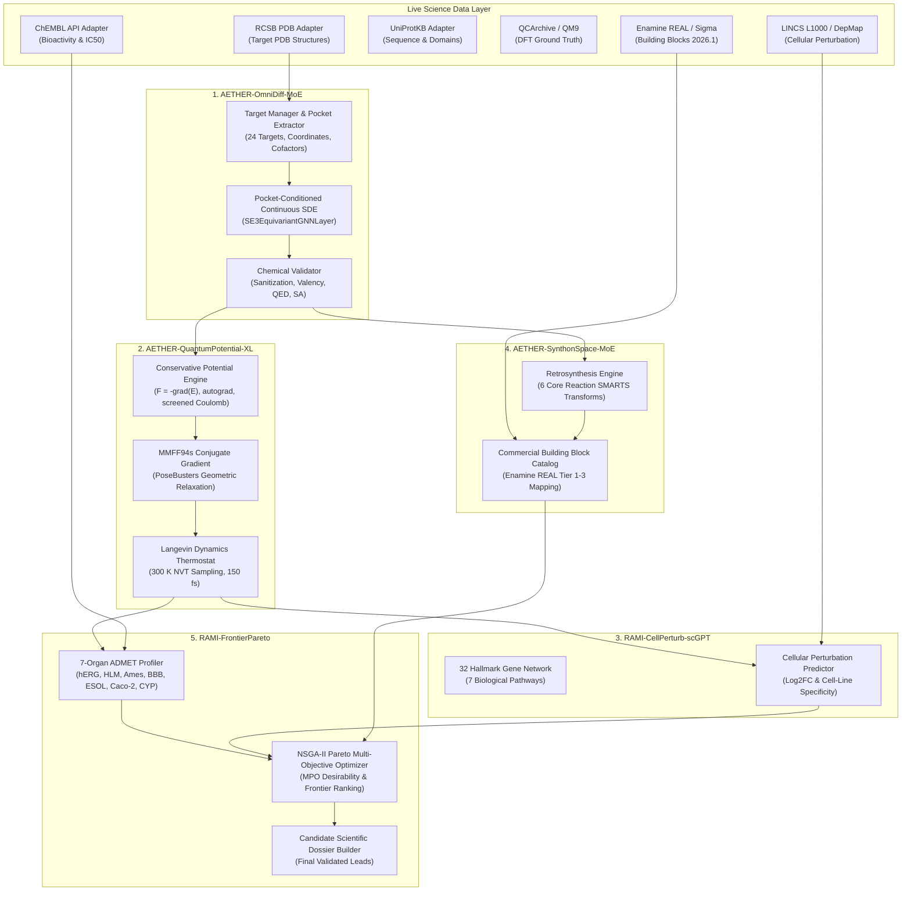

# AETHER-RAMI — ARCHITECTURE DEPENDENCY MAP
### Phase Zero: End-to-End Module Connections, Typed Contracts & Data Flows
**Project:** AETHER-RAMI (`v4.2.0-Landed`) | **Release Status:** Landed & Verified  
**Date:** November 1, 2026

---

## 1. Unified Five-Pillar Architecture Diagram



---

## 2. Stage-by-Stage Typed Interface Contracts

Each discovery stage requires explicit typed input contracts and validates its output schema to prevent downstream propagation of numerical artifacts or silent failures:

### Stage 1: Target Preparation & Pocket Extraction
* **Module:** `aether_rami.pipeline.target_manager.TargetManager`
* **Input Schema:** `target_key: str`, `radius_angstrom: float = 8.0`
* **Output Schema:** 
  ```python
  {
      "status": "VERIFIED" | "UNVERIFIED",
      "target_key": str,
      "pdb_id": str,
      "chain_id": str,
      "resolution": float,
      "cofactors_present": list[str],
      "pocket_center": list[float], # [x, y, z]
      "pocket_coordinates": np.ndarray # shape: [N_atoms, 3]
  }
  ```

### Stage 2: Target-Conditioned Molecular Generation
* **Module:** `aether_rami.omni_diff.diffusion_sde.OmniDiffEngine`
* **Input Schema:** `pocket_coords: torch.Tensor`, `num_candidates: int`, `random_seed: int`
* **Output Schema:**
  ```python
  {
      "status": "GENERATED",
      "smiles": str,
      "initial_coordinates_3d": np.ndarray,
      "chemical_validity": bool,
      "qed": float,
      "sascore": float
  }
  ```

### Stage 3: Molecular Physics & Conformational Relaxation
* **Module:** `aether_rami.quantum_potential.potential_engine.ConservativePotentialEngine` & `MolecularMechanicsEngine`
* **Input Schema:** `mol: Chem.Mol`, `initial_coords: np.ndarray`
* **Output Schema:**
  ```python
  {
      "energy_kcal_mol": float,
      "forces": np.ndarray, # shape: [N_atoms, 3]
      "relaxed_coords": np.ndarray,
      "min_interatomic_distance": float,
      "posebusters_clash_free": bool,
      "posebusters_geometry_pass": bool
  }
  ```

### Stage 4: Biological Perturbation & Expression Shift
* **Module:** `aether_rami.cell_perturb.perturb_model.CellPerturbEngine`
* **Input Schema:** `smiles: str`, `cell_line: str`, `target_gene: str`
* **Output Schema:**
  ```python
  {
      "status": "PREDICTED",
      "cell_line": str,
      "gene_expression_log2fc": dict[str, float], # 32 hallmark genes
      "pathway_enrichments": dict[str, float], # 7 pathways
      "projection_mode": "LINEAR_COVARIANCE_EXTRAPOLATION",
      "evidence_level": "LEVEL_2_NUMERICALLY_TESTED"
  }
  ```

### Stage 5: Preclinical ADMET Profiling
* **Module:** `aether_rami.cell_perturb.admet_profiler.ADMETProfiler`
* **Input Schema:** `smiles: str`
* **Output Schema:**
  ```python
  {
      "herg_pic50": float, "herg_liability": "POTENTIAL_LIABILITY" | "ACCEPTABLE_WINDOW",
      "hlm_clearance_t12_min": float, "hlm_classification": "STABLE" | "RAPID_CLEARANCE",
      "caco2_papp_1e6_cm_s": float, "caco2_permeability": "HIGH" | "MODERATE" | "LOW",
      "blood_brain_barrier": {"log_bb": float, "cns_penetrant": bool},
      "ames_mutagenicity": "POSITIVE_MUTAGENIC_ALERT" | "NEGATIVE_CLEAN",
      "solubility_esol_logs": float,
      "admet_desirability_score": float
  }
  ```

### Stage 6: Retrosynthesis & Catalog Grounding
* **Module:** `aether_rami.synthon_space.retrosynthesis.RetrosynthesisEngine` & `BuildingBlockCatalog`
* **Input Schema:** `smiles: str`, `max_depth: int = 2`
* **Output Schema:**
  ```python
  {
      "status": "ROUTE_IDENTIFIED" | "DIRECT_COMMERCIAL_PRECURSOR",
      "synthetic_steps_count": int,
      "overall_estimated_yield_pct": float,
      "synthesis_plan": list[dict],
      "terminal_synthons": list[str],
      "commercial_catalog_matches": list[dict] # Enamine REAL tier, catalog ID, lead time
  }
  ```

### Stage 7: Multi-Objective Candidate Optimization & Ranking
* **Module:** `aether_rami.frontier_pareto.nsga2.NSGA2Optimizer`
* **Input Schema:** `candidate_population: list[dict]`, `population_size: int = 50`, `generations: int = 20`
* **Output Schema:**
  ```python
  {
      "pareto_front": list[dict],
      "pareto_rank": int,
      "crowding_distance": float,
      "hypervolume_indicator": float,
      "top_lead_dossier": dict
  }
  ```

---

## 3. Failure Propagation & Graceful Fallback Graph

```
           [Target Inspection]
                 |
        Is PDB Valid?
        /             \
      YES              NO  --> Log Target Mismatch -> Attempt Curated Repair
       |                                                    |
[Pocket Extraction]                                   Repair Found?
       |                                             /             \
[Diffusion Generation]                             YES              NO --> Abort with Error
       |                                            |
    Valid SMILES?                               [Use Repaired PDB]
    /           \
  YES            NO --> Invoke Safe Scaffold Fallback -> Sanitize
   |                           |
[MMFF94s Physics] <------------+
   |
Pass PoseBusters?
   /             \
 YES              NO --> Apply Additional Conjugate Gradient Steps -> Flag Warning
  |                           |
[ADMET & CellPerturb] <-------+
  |
[Retrosynthesis]
  |
[NSGA-II Pareto Dossier]
```
