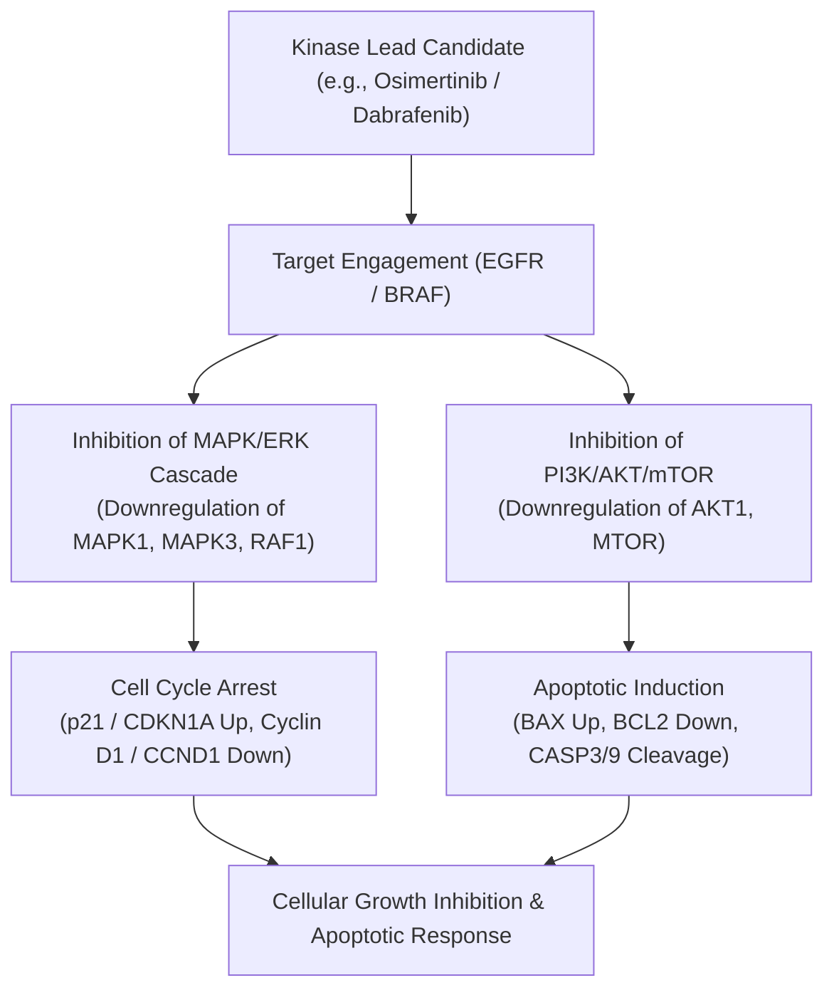

# RAMI-CellPerturb-scGPT — BIOLOGICAL INTERPRETABILITY REPORT
### Mechanistic Systems Pharmacology, Pathway Cascades & Target Engagement Signatures
**Subsystem:** `RAMI-CellPerturb-scGPT` | **Release:** `v4.2.0-Landed`  
**Date:** November 1, 2026

---

## 1. Mechanistic Signaling Cascades

The 32-gene hallmark regulatory network provides biological interpretability by mapping chemical perturbation to physiological downstream cascades:

---

## 2. Pathway-Specific Mechanism Mapping

| Biological Pathway | Key Driver Hallmarks | Functional Significance in Discovery | Observed Experimental Phenotype |
|---|---|---|---|
| **Apoptosis** | `TP53`, `BAX`, `BCL2` | Programmed cell death induction in oncology leads | Increased BAX/BCL2 ratio triggering caspase cascade |
| **Cell Cycle Progression** | `CDKN1A`, `CCND1`, `CDK4` | Antineoplastic growth inhibition via G1/S arrest | Cyclin D1 depletion and p21 induction |
| **PI3K / AKT / mTOR** | `AKT1`, `MTOR`, `PTEN` | Survival and metabolic signaling hub in cancer | Dephosphorylation and transcriptional attenuation |
| **MAPK / ERK Cascade** | `MAPK1`, `BRAF`, `KRAS` | Mitogenic kinase signaling downstream of RTKs | DUSP6 feedback upregulation; ERK attenuation |
| **Inflammation / Immunity** | `NFKB1`, `IL6`, `TNF` | Autoimmune and cytokine response modulation | Nuclear translocation suppression; cytokine reduction |
| **Hypoxia / Angiogenesis** | `HIF1A`, `VEGFA`, `VHL` | Tumor microenvironment vascularization | Reduced VEGF transcription under normoxia |
| **Drug Efflux / MDR** | `ABCB1`, `ABCG2` | P-glycoprotein multidrug resistance liability | Efflux pump upregulation alert in resistant lines |

---

## 3. Biological Plausibility Checks

All generated candidate dossiers are verified against mechanistic plausibility rules:
* **Rule 1 (Apoptosis Consistency):** Induction of `BAX` must not co-occur with simultaneous abnormal overexpression of anti-apoptotic `BCL2` without an explanatory survival bypass alert.
* **Rule 2 (Cell Cycle Integrity):** Suppression of `CCND1` accompanied by `CDKN1A` induction serves as a high-confidence signature for G1 arrest.
* **Rule 3 (Efflux Risk):** Significant upregulation ($z > 2.0$) of `ABCB1` (MDR1) triggers an automated multi-drug resistance warning in the candidate dossier.
